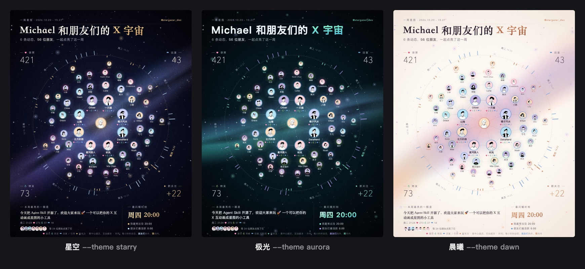

# x-circle-agent-skill

**[Name] 和朋友们的 X 宇宙**: an agent skill that turns your last 7 days on X into a constellation poster, so you can thank the people who showed up for you.


- Your friends are the stars. Everyone who liked, reposted, replied, quoted or mentioned you gets a place on the map, and the more they engaged, the closer their orbit. You sit quietly at the center, drawn about the same size as they are.
- New followers shine on the gold outer halo with a ✦.
- An outer dial traces the week hour by hour: friends' activity points outward, yours points inward, and the brightest hour is marked.
- The corners hold the week's likes, replies, reposts and new followers. Below the map are the top post with the people who lit it up and the brightest hour (最闪耀时刻).
- Optional: a 15-second 9:16 video in which a radar sweep circles the week and reveals the stars one by one. A soft generated soundtrack follows along, with a chime for each star as it lights up. Pass `--no-music` for a silent video.
- Three looks, and simple ways to make it yours (see [Themes and options](#themes-and-options)).

All data is collected **read-only** by your agent browsing x.com in your own logged-in browser. The page script only reads what is on screen, and progress is kept in a local file, never in x.com's storage. No API keys are needed and nothing is posted for you.

## Install

```bash
npx skills add wkf2000/x-circle-agent-skill
```

Requirements:
- Node 18+ and Google Chrome (or Edge / Chromium) for rendering
- `ffmpeg` for the optional video
- An agent whose browser can open pages, scroll and run read-only JavaScript, logged in to x.com. This works in Claude Code (built-in browser or Claude in Chrome), Codex (in-app browser) and other harnesses.

## Use

Ask your agent:

> 帮我生成这周的 X 宇宙

> Make my X universe for this week, with a video

The agent visits your profile, your notifications and your most engaged posts from the past week (replies, likes, reposts, quotes). A small local CLI (`collect.mjs`) tells it which page to open next and keeps the results. It then writes `./x-universe/<date>/x-universe.png` (and `.mp4`).

## Themes and options



The default is 星空 (starry). Once your map is made, just tell the agent what you'd like changed. It re-renders in seconds without visiting X again.

| Say something like | What changes |
|---|---|
| 换成极光 / 用晨曦风格 | Theme: 星空 `starry`, 极光 `aurora`, 晨曦 `dawn` (light) |
| 给我看看三种风格 | A side-by-side preview of all three, like the one above |
| 做个英文版 | All text on the image in English |
| 标题改成「…」 / 结尾换成「…」 | Custom title, subtitle, name, or the video's closing line |
| 不要显示获赞数 | Hide any of likes, replies, reposts, new followers, posts |
| 去掉 @xxx | Leave accounts (spam, bots) off the map; the next friends move up |
| 视频短一点 / 不要音乐 | Video length from 8 to 30 seconds; silent video |

The agent also points out accounts that look like spam and asks before leaving them out.

## Try the renderer without X

```bash
cd skills/x-circle-agent-skill/scripts
npm install
node render.mjs ../assets/sample-data.json --out /tmp/x-universe --video
node render.mjs ../assets/sample-data.json --out /tmp/x-universe --preview-themes   # all three themes side by side
node render.mjs ../assets/sample-data.json --out /tmp/x-universe --theme dawn --lang en
```

## Notes

- X does not show timestamps for likes, reposts or follows, so the active-time chart uses your own posts and replies plus timestamped replies, quotes and mentions from others.
- Only the author of a post can see who liked it, so the skill only works on your own account.

## License

MIT
